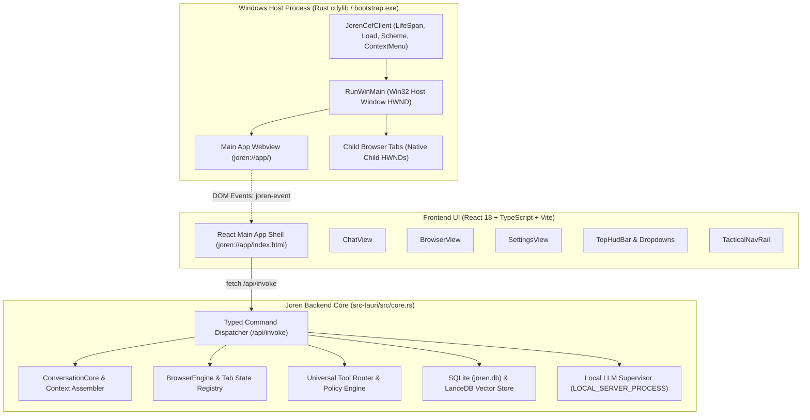
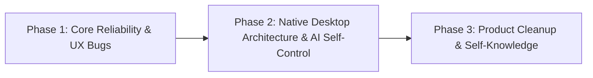

# Joren — Next Development Cycle Implementation Plan
**Document Version:** 2.1.0 (Final Approved Architecture & Review Revisions)  
**Status:** Under Final Review (Awaiting User Approval / Proceed)  
**Author:** Principal Software Architect & Engineering Lead  
**Target Repository:** `https://github.com/sumit0879-dev/Joren`  
**Base Branch:** `main` (Commit `87f670de4f90a95ceaa8a6b4e0e98390034cf1dd`)  

---

## 1. Executive Summary

This implementation plan governs the next major maintenance, stabilization, and architectural improvement cycle of **Joren**, a local-first Windows desktop AI assistant. Following the successful migration from WebView2 to a sandboxed Chromium Embedded Framework (CEF 156.0.15) desktop runtime merged via PR #2, testing identified specific functional defects in chat persistence, browser tab lifecycle, navigation controls, and UI layering, alongside an unexpected command-prompt flash during shutdown. Additionally, two features were designated for complete removal (Joren Dev Agent, and the standalone Vector Memory UI tab while preserving its backend), while two capabilities were requested for strategic enhancement (dynamic model discovery and programmatic AI self-control).

This finalized plan incorporates all technical corrections from user review:
1. **Chat Persistence Safety:** Non-destructive duplicate audit scan; elimination of automated text-based deletions; unique idempotency keys for all new writes; and a verified, single timestamped backup path.
2. **Asynchronous Tab Closing Lifecycle:** Safe tracking of closing tabs in an internal `closing_tabs` registry until CEF's `OnBeforeClose` callback completes, preventing resurrected tabs while avoiding reference leaks.
3. **CEF 156 Context Menu Execution:** Signature-accurate `void` `on_before_context_menu` and `on_context_menu_command` handlers dispatching native editing commands (Undo, Cut, Copy, Paste, Delete, Select All) on editable controls while preserving standard Chromium context menus inside website tabs.
4. **Concrete Airspace Coordination:** A dual-mode native overlay coordination architecture pairing responsive non-overlapping side drawers with coordinate-aware Win32 surface clipping (`SetWindowRgn`) for floating popovers, validated against an explicit acceptance test suite.
5. **Per-Monitor V2 DPI & Dynamic Geometry:** Viewport derivation from live DOM geometry scaled by window DPI (`GetDpiForWindow`), supporting multi-monitor virtual screen coordinates without double-scaling.
6. **Provider-Specific Dynamic Discovery:** Dedicated discovery endpoints, authentication schemes, and JSON response parsers for Groq, Google Gemini, OpenAI, OpenRouter, DeepSeek, Together, Ollama, and local Llama endpoints, initializing all model arrays to empty (`[]`) until fetched.
7. **Accurate Runtime Self-Knowledge:** Identity, version, platform, and CEF runtime derived dynamically from build/runtime metadata, clearly delineating local storage, local offline inference, and network-dependent features.
8. **Unified Shutdown Management:** Direct lifecycle reuse of `LOCAL_SERVER_PROCESS` in `llm.rs` via a synchronous helper, eliminating all `taskkill` console flashes and protecting external processes.
9. **Deterministic Browser Integration Test Suite:** An automated 9-point CEF test suite verifying navigation, DOM inspection, element clicks, typing, Back/Forward/Reload, tab lifecycle, history logging, overlay persistence, context menus, and internal AI navigation.

The plan retains the established **three-phase engineering roadmap** without unnecessary fragmentation.

---

## 2. Current Architecture Summary



- **Host Process:** Win32 executable (`bootstrap.exe` renamed to `joren.exe`) dynamically loading `joren.dll` via exported `RunWinMain`.
- **Runtime:** Pinned CEF 156.0.15 (`cef-dll-sys 156.3.0`) with mandatory Chromium sandbox enabled (`no_sandbox = 0`).
- **Frontend Delivery:** Custom secure scheme `joren://app/` served in-process by `JorenSchemeHandlerFactory`, eliminating localhost HTTP ports.
- **Backend IPC:** Bidirectional typed IPC. React communicates to Rust via `POST /api/invoke` intercepted by `scheme.rs`. Rust pushes asynchronous events to the React window via `window.dispatchEvent(new CustomEvent('joren-event', { detail: { event, payload } }))`.
- **Compatibility Layer:** `src-tauri/tauri-compat` acts as an in-tree facade replicating `tauri::command`, `AppHandle`, and `State` without linking official Tauri/WRY/WebView2 crates.

---

## 3. Root Cause Analysis for Every Reported Issue

### Bug Group A: Chat Message Duplication & Token Waste
- **Severity:** High (Data Redundancy & Token Waste)
- **Confidence:** Confirmed (100% verified via source call chains)
- **Evidence & Quantitative Mechanics:**
  1. [`src/views/ChatView.tsx#L229`](file:///e:/Projects/Joren/src/views/ChatView.tsx#L229): Frontend optimistically invokes `tauriService.saveSessionMessage(targetSessionId, 'user', text.trim(), timestamp)` upon user submission, writing Row 1 to SQLite.
  2. [`src-tauri/src/conversation/core.rs#L136-L142`](file:///e:/Projects/Joren/src-tauri/src/conversation/core.rs#L136-L142): `submit_turn()` independently writes the user prompt via `db::save_session_message()`, writing Row 2 to SQLite.
  3. [`src-tauri/src/conversation/core.rs#L204`](file:///e:/Projects/Joren/src-tauri/src/conversation/core.rs#L204): `execute_turn()` loads conversation history from SQLite via `db::get_session_messages()`, obtaining both stored user rows.
  4. [`src-tauri/src/conversation/context.rs#L174-L181`](file:///e:/Projects/Joren/src-tauri/src/conversation/context.rs#L174-L181): `assemble_messages_with_model()` appends all loaded history rows (containing the 2 stored user copies) and then unconditionally appends `messages.push(ChatMessage::user(current_input.to_string()))`, resulting in **exactly 3 copies of the user prompt** transmitted to the LLM on that turn.
  5. [`src-tauri/src/conversation/core.rs#L588`](file:///e:/Projects/Joren/src-tauri/src/conversation/core.rs#L588) & [`src/views/ChatView.tsx#L294`](file:///e:/Projects/Joren/src/views/ChatView.tsx#L294): Both backend and frontend save the assistant response, writing 2 assistant rows per turn to SQLite.
- **Impact:** SQLite stores exactly 2 user rows and 2 assistant rows per turn. The immediate model context contains 3 copies of the user prompt, inflating token consumption and degrading instruction adherence.
- **Proposed Correction:** Establish `ConversationCore` as the sole persistence authority. Remove client-side calls in `ChatView.tsx`. Introduce a unique `idempotency_key` (client request nonce) and backend `turn_id` column in SQLite. Decouple client request idempotency from authoritative TurnId. In `assemble_messages_with_model()`, ensure history assembly includes the prompt exactly once based on turn metadata rather than raw text matching.

---

### Bug Group B: Browser Tab Lifecycle & Persistence
- **Severity:** Medium (State Desynchronization)
- **Confidence:** Confirmed
- **Evidence:**
  1. [`src-tauri/src/cef/tabs.rs#L842-L885`](file:///e:/Projects/Joren/src-tauri/src/cef/tabs.rs#L842-L885): In `close_tab()`, when a real CEF tab (`ptr != 0`) is closed, `(*host).close_browser(host, 1)` is called asynchronously, but the tab is not removed from active state during that call.
  2. [`src/views/BrowserView.tsx#L414-L415`](file:///e:/Projects/Joren/src/views/BrowserView.tsx#L414-L415): `handleCloseTab()` executes `await browserController.closeTab(targetId)` followed immediately by `browserController.saveSession()`.
  3. [`src-tauri/src/cef/tabs.rs#L999-L1006`](file:///e:/Projects/Joren/src-tauri/src/cef/tabs.rs#L999-L1006): `save_session()` snapshots `guard.tabs` into `%APPDATA%\Joren\last_session.json`. Because the tab was still in `guard.tabs`, it is written back into the session file.
  4. [`src/views/BrowserView.tsx#L312-L329`](file:///e:/Projects/Joren/src/views/BrowserView.tsx#L312-L329): Navigating between views remounts `BrowserView` and calls `initTabs()`, which loads `browserGetMultiState()` and restores the unpurged tab.
- **Impact:** Explicitly closed tabs reappear when navigating between views.
- **Proposed Correction:** Implement a two-stage lifecycle:
  - When `close_tab()` is invoked: immediately hide the native window (`place_hwnd(hwnd, ..., false)`), move the tab into an internal `closing_tabs` registry, switch `active_id` to the next open tab, and update `last_session.json` excluding the closing tab.
  - When CEF's asynchronous destruction completes and triggers `OnBeforeClose` -> `tabs::note_closed()`: locate the tab in `closing_tabs`, release the native browser reference, and move metadata to `closed_history`.

---

### Bug Group C: Browser Navigation Controls (Back, Forward, Reload)
- **Severity:** Medium (Broken Core Functionality)
- **Confidence:** Confirmed
- **Evidence:**
  1. [`src-tauri/src/cef/tabs.rs#L181-L182`](file:///e:/Projects/Joren/src-tauri/src/cef/tabs.rs#L181-L182): `can_go_back` and `can_go_forward` are hardcoded to `false` in `tab_json()`.
  2. [`src-tauri/src/cef/tabs.rs#L703-L717`](file:///e:/Projects/Joren/src-tauri/src/cef/tabs.rs#L703-L717): In `nav(id, which)`, `ptr` is 0 for unpromoted virtual tabs (`joren://newtab`), causing `call_nav()` to receive null and return silently.
  3. [`src-tauri/src/cef/tabs.rs#L331-L353`](file:///e:/Projects/Joren/src-tauri/src/cef/tabs.rs#L331-L353): In `call_nav()`, calls to `(*browser).go_back`, `(*browser).go_forward`, and `(*browser).reload` are invoked without checking navigation history or frame state.
- **Impact:** Back, Forward, and Reload toolbar buttons do not respond to clicks.
- **Proposed Correction:** Query live navigation capability from CEF (`(*browser).can_go_back` / `can_go_forward`), pipe state changes to frontend button enablement, verify tab promotion before dispatching, and invoke navigation on the CEF UI thread.

---

### Bug Group D: Browser Web View Disappearing on Dropdowns/Downloads/Menus
- **Severity:** High (Severe UX Glitch)
- **Confidence:**
  - *Download & Three-dot navigation:* **Confirmed**
  - *Top Model Selector layout/clipping interaction:* **Confirmed** (Child HWND draws over parent DirectComposition surface, causing bounds reset or visual occlusion)
- **Evidence:**
  1. [`src/views/BrowserView.tsx#L610`](file:///e:/Projects/Joren/src/views/BrowserView.tsx#L610): Clicking Download calls `handleNavigate(undefined, 'joren://downloads')`.
  2. [`src/views/BrowserView.tsx#L626`](file:///e:/Projects/Joren/src/views/BrowserView.tsx#L626): Clicking Three-Dot calls `handleNavigate(undefined, 'joren://settings')`.
  3. Navigating the active tab to internal routes causes [`tabs.rs#L660, L755`](file:///e:/Projects/Joren/src-tauri/src/cef/tabs.rs#L660) to set `is_internal = true` and hide the native CEF window via `place_hwnd(hwnd, bounds, false)`.
  4. Top Model Selector: Opening the dropdown updates state in `AppContext`, triggering `BrowserView` re-renders and bounds recalculation via `syncBounds()`. In Windowed CEF, because the child HWND draws in front of the parent window, the floating menu cannot render above the child HWND without explicit clipping.
- **Impact:** Interacting with toolbar controls navigates away from the active website or blanks the view.
- **Proposed Correction:** Replace `handleDownloadsMenu` with a slide-over drawer and `handleOverflowMenu` with an in-place action menu. Coordinate native child HWND clipping (`SetWindowRgn`) when the model selector dropdown opens, allowing the React popover to render through cleanly without unmounting or hiding the browser surface.

---

### Bug Group E: Browser History Not Available / Not Saving
- **Severity:** Medium (Missing Feature)
- **Confidence:** Confirmed
- **Evidence:**
  1. [`src-tauri/src/browser_storage.rs#L11`](file:///e:/Projects/Joren/src-tauri/src/browser_storage.rs#L11): `browser_history_add()` correctly inserts entries into SQLite.
  2. [`src/services/tauri.ts#L1545`](file:///e:/Projects/Joren/src/services/tauri.ts#L1545): Frontend binding exists.
  3. Neither `on_load_end` in [`src-tauri/src/cef/mod.rs`](file:///e:/Projects/Joren/src-tauri/src/cef/mod.rs) nor `note_navigation` in [`src-tauri/src/cef/tabs.rs`](file:///e:/Projects/Joren/src-tauri/src/cef/tabs.rs) calls `browser_history_add`.
- **Impact:** The `browser_history` table remains empty; the History view displays nothing.
- **Proposed Correction:** Hook `JorenLoadHandler::on_load_end` to record successful main-frame navigations to external HTTP/HTTPS URLs into SQLite with page title, URL, and timestamp.

---

### Bug Group F: Right-Click Context Menu Showing Default Browser Items Everywhere
- **Severity:** Low/Medium (Non-Native Desktop Polish)
- **Confidence:** Confirmed
- **Evidence:**
  1. [`src-tauri/src/cef/mod.rs#L695-L720`](file:///e:/Projects/Joren/src-tauri/src/cef/mod.rs#L695-L720): `JorenCefClient` leaves `get_context_menu_handler = None`.
  2. Chromium falls back to default browser menus ("Back", "Forward", "Reload", "Inspect") across the entire window.
- **Impact:** Right-clicking application UI displays webpage navigation options.
- **Proposed Correction:** Implement `_cef_context_menu_handler_t` in `JorenCefClient`. In `on_before_context_menu(..., model)` (returning `void` in CEF 156), check if the browser is `MAIN_BROWSER`. If so, call `(*model).clear(model)` and insert standard editing commands (Undo, Cut, Copy, Paste, Delete, Select All) if the clicked element is editable. In `on_context_menu_command`, dispatch the corresponding frame editing commands (`frame.undo()`, `frame.cut()`, `frame.copy()`, `frame.paste()`, `frame.del()`, `frame.select_all()`). For child website browsers, preserve standard Chromium menus.

---

### Bug Group G: Airspace & Native Overlay Architecture
- **Severity:** High (Architectural Constraint)
- **Confidence:** Confirmed
- **Evidence:**
  1. Website tabs run as native Win32 child windows (`HWND`) parented to the main application window (`src-tauri/src/cef/tabs.rs#L508`).
  2. Win32 child windows draw in a separate clipping hierarchy above the parent window's DirectComposition surface. React DOM elements cannot draw on top of a child HWND without clipping or native coordination.
- **Impact:** Overlays (e.g. dropdowns, modals) cannot visually overlap native child browser windows without clipping artifacts.
- **Proposed Correction:** Establish an explicit overlay coordination design combining responsive slide-overs with Win32 `SetWindowRgn` clipping. See Section 10 for Windowed CEF vs. OSR evaluation and empirical verification plan.

---

### Bug Group H: External AI Links Replacing Main Joren UI
- **Severity:** High (Application Disruption)
- **Confidence:** Confirmed
- **Evidence:**
  1. [`src/views/ChatView.tsx#L637-L654`](file:///e:/Projects/Joren/src/views/ChatView.tsx#L637-L654): `<ReactMarkdown>` lacks an anchor (`a`) component override.
  2. Clicking links triggers standard navigation in the main CEF browser frame (`joren://app/index.html`).
  3. Main browser client lacks `_cef_request_handler_t::on_before_browse` to block external navigations.
- **Impact:** Clicking AI links navigates the main app away to external sites, unmounting React.
- **Proposed Correction:** Override `a` in `ReactMarkdown` to intercept clicks, invoke `browserController.createTab(href)`, and switch active view to `browser`. Implement `on_before_browse` on the main browser to reject out-of-origin navigations.

---

### Bug Group I: AI Self-Control & Cursorless App Navigation
- **Severity:** Medium (Autonomous Capability Limitation)
- **Confidence:** Confirmed
- **Evidence:**
  1. [`src-tauri/src/tools/domains/computer.rs#L126-L190`](file:///e:/Projects/Joren/src-tauri/src/tools/domains/computer.rs#L126-L190): Tools are limited to low-level OS inputs (`move_cursor`, `click`, `type`).
  2. The AI lacks internal programmatic tools to navigate Joren views or control browser tabs.
  3. [`src-tauri/src/tools/domains/computer_platform.rs#L398-L407`](file:///e:/Projects/Joren/src-tauri/src/tools/domains/computer_platform.rs#L398-L407): `move_cursor()` uses raw `SetCursorPos` with `SM_CXSCREEN`/`SM_CYSCREEN` without Per-Monitor V2 DPI conversion, failing on scaled and multi-monitor setups.
- **Impact:** The AI cannot switch views cleanly and relies on inaccurate mouse cursor automation.
- **Proposed Correction:** Provide first-class `app_control` tools (`app.get_status`, `app.navigate_view`, `app.open_browser_url`). Implement Per-Monitor V2 DPI awareness in `computer_platform.rs` for external Windows automation.

---

### Shutdown Bug: Flashing CMD Window on Application Exit
- **Severity:** Low/Medium (Visual Polish)
- **Confidence:** Confirmed
- **Evidence:**
  1. [`src-tauri/src/cef/mod.rs#L1069-L1071`](file:///e:/Projects/Joren/src-tauri/src/cef/mod.rs#L1069-L1071): In `WM_CLOSE`:
     ```rust
     let _ = std::process::Command::new("taskkill")
         .args(["/F", "/IM", "llama-server.exe"])
         .output();
     ```
  2. Calling `Command::new("taskkill")` without `CREATE_NO_WINDOW` (`0x08000000`) spawns a temporary console window that flashes on screen.
  3. [`src-tauri/src/llm.rs#L31`](file:///e:/Projects/Joren/src-tauri/src/llm.rs#L31): An existing global child manager `LOCAL_SERVER_PROCESS: Mutex<Option<Child>>` and `stop_local_llm()` already exist in `llm.rs`.
- **Impact:** A black command prompt flashes every time Joren closes, and unrelated system processes could be terminated.
- **Proposed Correction:** Remove the global `taskkill` invocation entirely. Expose a synchronous helper `stop_local_llm_sync()` in `src-tauri/src/llm.rs` that reuses `LOCAL_SERVER_PROCESS`, terminating only Joren's owned child process handle.

---

## 4. Confirmed vs. Probable Diagnoses Matrix

| Issue ID | Description | Status | Evidence |
| :--- | :--- | :--- | :--- |
| **A-1** | Chat triple user prompt in context | **Confirmed** | Verified in `ChatView.tsx:229`, `core.rs:136`, `context.rs:174-181` |
| **A-2** | Chat duplicate assistant rows | **Confirmed** | Verified in `core.rs:588` and `ChatView.tsx:294` |
| **B-1** | Closed browser tab resurfacing | **Confirmed** | Verified in `tabs.rs:842-885` and `last_session.json` persistence |
| **C-1** | Back/Forward/Reload buttons non-functional | **Confirmed** | Verified hardcoded `can_go_back: false` and null-pointer checks in `tabs.rs:331` |
| **D-1** | Webview disappears on Download/3-Dot click | **Confirmed** | Verified `BrowserView.tsx:610,626` triggering internal route navigation |
| **D-2** | Webview blanking on Model menu click | **Confirmed** | Verified Win32 child HWND z-order occlusion and bounds recalculation |
| **E-1** | History not recording or appearing | **Confirmed** | Verified `browser_history_add` is never called in navigation lifecycle |
| **F-1** | Web context menu appears on application UI | **Confirmed** | Verified `mod.rs:695` missing `get_context_menu_handler` |
| **G-1** | Win32 Airspace limitation | **Confirmed** | Verified Win32 DWM child HWND clipping hierarchy |
| **H-1** | AI links replace main application UI | **Confirmed** | Verified `ChatView.tsx:637` ReactMarkdown missing `a` handler |
| **I-1** | AI mouse cursor navigation failure | **Confirmed** | Verified `computer.rs` lacks internal tools; DPI mismatch in `computer_platform.rs` |
| **S-1** | CMD window flashing on exit | **Confirmed** | Verified unflagged `taskkill` in `mod.rs:1069`; existing `LOCAL_SERVER_PROCESS` in `llm.rs` |

---

## 5. Scope Boundary & Explicit Exclusions

### In Scope:
1. Fixing all 9 reported bugs and the shutdown command window issue.
2. Complete end-to-end removal of the Joren Dev Agent feature.
3. Removal of the separate Vector Memory UI navigation tab (Alt+4) while preserving backend memory services.
4. Replacement of hardcoded provider model lists with authenticated dynamic model discovery.
5. Implementation of Joren self-knowledge and programmatic `app_control` capabilities.
6. Clean native window composition and bounds coordination.

### Explicit Exclusions:
1. **Deferred Large Future Feature:** The unspecified separate large future feature mentioned by the user is strictly excluded from this cycle.
2. **No Unrelated Redesigns:** Do not alter the cybernetic tactical HUD aesthetic, color palette, or typography unless explicitly required to fix a bug.
3. **No Unnecessary Dependency Bumps:** Do not upgrade major dependencies (e.g. React 19, Vite 7) unless required by security or build requirements.
4. **No WebView2 Re-introduction:** The project will remain 100% on sandboxed CEF 156 on Windows.

---

## 6. Three-Phase Implementation Roadmap



---

## 7. Detailed Phase Breakdown

### Phase 1: Core Reliability & UX Bugs

#### Task 1.1: Chat Deduplication & Authoritative Persistence
- **Files to Modify:**
  - `src/views/ChatView.tsx`
  - `src-tauri/src/conversation/core.rs`
  - `src-tauri/src/conversation/context.rs`
  - `src-tauri/src/db.rs`
- **Actions:**
  1. In `src/views/ChatView.tsx`, remove client-side `tauriService.saveSessionMessage()` calls at L229 and L294. Make backend `ConversationCore` the sole persistence authority.
  2. In `src-tauri/src/db.rs`, add an `idempotency_key` column and unique index to the `messages` table:
     ```sql
     ALTER TABLE messages ADD COLUMN idempotency_key TEXT;
     CREATE UNIQUE INDEX IF NOT EXISTS idx_messages_idempotency ON messages(session_id, idempotency_key) WHERE idempotency_key IS NOT NULL;
     ```
  3. In `src-tauri/src/conversation/core.rs`, pass `client_turn_id` as the `idempotency_key` for the user message and `{client_turn_id}-assistant` for the response. Keep client request idempotency strictly separate from backend `turn_id`. Use `INSERT OR IGNORE`.
  4. Ensure all persistence paths (standard turn execution, legacy fallback `chatCommand`, tool execution, and stream reconnects) route through this single persistence gate.
  5. In `src-tauri/src/conversation/context.rs` (`assemble_messages_with_model`), ensure the current prompt is not duplicated if already present in history. Do not compare raw message text; rely on turn provenance.
  6. **Data Migration Safety:** 
     - Create a single verified backup: `%APPDATA%\Joren\backups\joren.db.backup.<timestamp>.bak`. Assert file exists and byte size > 0 before migration.
     - Execute a diagnostic audit scan query logging duplicate turn candidates without deleting them:
       `[MIGRATION_AUDIT] Found X duplicate turn rows across Y sessions`.
     - **Do not execute automated text-based deletions.** Historical legacy data remains audit-only unless proven identical via reliable turn provenance. Legitimate repeated user messages (e.g. "yes", "retry") are strictly preserved.
     - All new writes enforce the unique `idempotency_key`.
- **Verification:** Submit messages, refresh page, switch sessions. Verify each message appears exactly once. Verify assembled model context contains exactly one copy of the latest prompt.

#### Task 1.2: Browser Tab Close & Session Persistence
- **Files to Modify:**
  - `src-tauri/src/cef/tabs.rs`
  - `src/views/BrowserView.tsx`
  - `src/services/browserController.ts`
- **Actions:**
  1. In `src-tauri/src/cef/tabs.rs`, introduce a `closing_tabs: Vec<TabRec>` registry in `TabState`.
  2. When `close_tab(id)` is called:
     - Immediately hide the native window: `place_hwnd(hwnd, bounds, false)`.
     - Move the `TabRec` from active `tabs` to `closing_tabs`.
     - Update `guard.active_id` to the next available tab.
     - Call `(*host).close_browser(host, 1)` asynchronously.
     - Immediately update `%APPDATA%\Joren\last_session.json` containing only remaining active `tabs`.
  3. When Chromium finishes teardown and triggers `OnBeforeClose(browser)` -> `tabs::note_closed(browser)`:
     - Locate the tab in `closing_tabs`, release the native browser reference (`release_browser(ptr)`), and move metadata to `closed_history`.
  4. In `BrowserView.tsx`, update state immediately on close and do not resurrect closed tabs in `initTabs()`.
- **Verification:** Open multiple tabs, navigate to websites, close one tab, switch to ChatView, return to BrowserView. Verify closed tab does not reappear. Verify no reference count leaks occur in CEF.

#### Task 1.3: Browser Navigation Controls (Back, Forward, Reload)
- **Files to Modify:**
  - `src-tauri/src/cef/tabs.rs`
  - `src/views/BrowserView.tsx`
  - `src/services/browserController.ts`
- **Actions:**
  1. In `src-tauri/src/cef/tabs.rs`, implement live capability queries against the CEF browser host:
     ```rust
     let can_go_back = (*browser).can_go_back.map(|f| f(browser) != 0).unwrap_or(false);
     let can_go_forward = (*browser).can_go_forward.map(|f| f(browser) != 0).unwrap_or(false);
     ```
  2. In `call_nav()`, dispatch navigation commands directly to the CEF browser instance on the UI thread.
  3. Wire live navigation state changes to frontend state so Back/Forward buttons enable/disable dynamically.
- **Verification:** Navigate page A -> page B. Click Back: verify page A loads. Click Forward: verify page B loads. Click Reload: verify page reloads.

#### Task 1.4: Fix Browser Disappearing on Downloads/3-Dot/Model Clicks
- **Files to Modify:**
  - `src/views/BrowserView.tsx`
  - `src/components/TopHudBar.tsx`
  - `src-tauri/src/cef/tabs.rs`
- **Actions:**
  1. In `BrowserView.tsx`, replace `handleDownloadsMenu` navigation to `joren://downloads` with an in-place slide-over drawer showing active downloads.
  2. Replace `handleOverflowMenu` navigation to `joren://settings` with a floating action menu (History, Bookmarks, Zoom, Print, Settings shortcut).
  3. Ensure the active website tab is never navigated away or replaced with internal URLs unless the user explicitly requests an internal tab.
  4. In `TopHudBar.tsx`, implement concrete overlay coordination: when the model selector popover opens, dispatch `browser_set_clipping_region` with the popover's bounding rectangle. The native host uses Win32 `SetWindowRgn` to punch a transparent region in the child HWND, allowing the React dropdown to render cleanly while the website remains visible, animated, and running beneath.
- **Verification:** Load a website. Open Model selector: verify website remains visible and running while dropdown renders cleanly on top. Click 3-dots: verify dropdown appears without page navigation. Click Downloads: verify drawer opens without blanking the page.

#### Task 1.5: Automatic Browser History Persistence
- **Files to Modify:**
  - `src-tauri/src/cef/mod.rs`
  - `src-tauri/src/cef/tabs.rs`
  - `src-tauri/src/browser_storage.rs`
- **Actions:**
  1. In `src-tauri/src/cef/mod.rs` (`JorenLoadHandler::on_load_end`), verify navigation is a main-frame load and HTTP status is successful (2xx/3xx).
  2. If the URL is an external web URL (not `joren://app/` or `about:blank`), invoke `crate::db::add_browser_history_entry` with final URL, page title, and current timestamp.
  3. Emit a `browser-history-updated` event so open History views update dynamically.
- **Verification:** Navigate to 3 websites. Open History: verify all 3 entries appear with proper titles and timestamps. Restart Joren: verify history persists.

#### Task 1.6: Native vs. Website Context Menu Scoping & Execution
- **Files to Modify:**
  - `src-tauri/src/cef/mod.rs`
  - `src-tauri/src/cef/types.rs`
  - `index.html`
- **Actions:**
  1. Implement `_cef_context_menu_handler_t` in `src-tauri/src/cef/mod.rs` with correct ABI signatures:
     ```rust
     // 1. Menu Population (returns void in CEF 156)
     unsafe extern "C" fn on_before_context_menu(
         _self: *mut _cef_context_menu_handler_t,
         browser: *mut _cef_browser_t,
         _frame: *mut _cef_frame_t,
         params: *mut _cef_context_menu_params_t,
         model: *mut _cef_menu_model_t,
     ) {
         let ptr = browser as usize;
         let is_main = {
             let guard = MAIN_BROWSER.lock().unwrap();
             *guard == Some(ptr)
         };
         if is_main {
             if let Some(clear) = (*model).clear {
                 clear(model);
             }
             // Add standard desktop editing actions if targeting editable content
             if let Some(get_flags) = (*params).get_type_flags {
                 let flags = get_flags(params);
                 if (flags & 0x08) != 0 { // CM_TYPEFLAG_EDITABLE
                     if let Some(add_item) = (*model).add_item {
                         let undo_s = cef_string_from_str("Undo");
                         let cut_s = cef_string_from_str("Cut");
                         let copy_s = cef_string_from_str("Copy");
                         let paste_s = cef_string_from_str("Paste");
                         let del_s = cef_string_from_str("Delete");
                         let sel_s = cef_string_from_str("Select All");
                         add_item(model, 100, &undo_s);
                         add_item(model, 101, &cut_s);
                         add_item(model, 102, &copy_s);
                         add_item(model, 103, &paste_s);
                         add_item(model, 104, &del_s);
                         add_item(model, 105, &sel_s);
                     }
                 }
             }
         }
         // For child website browsers, leave default Chromium model intact
     }

     // 2. Menu Command Execution (returns c_int: 1 = handled, 0 = default)
     unsafe extern "C" fn on_context_menu_command(
         _self: *mut _cef_context_menu_handler_t,
         browser: *mut _cef_browser_t,
         frame: *mut _cef_frame_t,
         _params: *mut _cef_context_menu_params_t,
         command_id: c_int,
         _event_flags: u32,
     ) -> c_int {
         let ptr = browser as usize;
         let is_main = {
             let guard = MAIN_BROWSER.lock().unwrap();
             *guard == Some(ptr)
         };
         if is_main && !frame.is_null() {
             let f = &*frame;
             match command_id {
                 100 => { if let Some(undo) = f.undo { undo(frame); } return 1; }
                 101 => { if let Some(cut) = f.cut { cut(frame); } return 1; }
                 102 => { if let Some(copy) = f.copy { copy(frame); } return 1; }
                 103 => { if let Some(paste) = f.paste { paste(frame); } return 1; }
                 104 => { if let Some(del) = f.del { del(frame); } return 1; }
                 105 => { if let Some(sel) = f.select_all { sel(frame); } return 1; }
                 _ => {}
             }
         }
         0
     }
     ```
  2. Allow standard text selection and copy/paste for input fields in `index.html`.
- **Verification:** Right-click in Chat header: verify no browser menu appears. Right-click inside an input field: verify Undo, Cut, Copy, Paste, Delete, Select All appear and execute correctly. Right-click on website text/link: verify standard Chromium browser menu appears and operates normally.

#### Task 1.7: Route External AI Links to Joren Browser
- **Files to Modify:**
  - `src/views/ChatView.tsx`
  - `src-tauri/src/cef/mod.rs`
- **Actions:**
  1. In `src/views/ChatView.tsx`, supply a custom `a` component to `<ReactMarkdown>`:
     ```tsx
     a({ href, children, ...props }: any) {
       return (
         <a
           href={href}
           onClick={(e) => {
             e.preventDefault();
             if (href && (href.startsWith('http://') || href.startsWith('https://'))) {
               browserController.createTab(`tab_${Date.now()}`, href);
               setActiveTab('browser');
             }
           }}
           className="text-cyan-400 hover:text-cyan-300 underline cursor-pointer"
           {...props}
         >
           {children}
         </a>
       );
     }
     ```
  2. In `src-tauri/src/cef/mod.rs`, implement `_cef_request_handler_t::on_before_browse` on the main application browser to reject any external navigations out of `joren://app/`.
- **Verification:** Prompt AI to provide a link. Click link: verify Joren switches to BrowserView and opens the link in a new tab; verify main chat shell is never replaced.

#### Task 1.8: Shutdown Process Cleanup & CMD Flash Elimination
- **Files to Modify:**
  - `src-tauri/src/cef/mod.rs`
  - `src-tauri/src/llm.rs`
- **Actions:**
  1. In `src-tauri/src/llm.rs`, expose a synchronous helper `stop_local_llm_sync()` reusing the existing `LOCAL_SERVER_PROCESS: Mutex<Option<Child>>`:
     ```rust
     pub fn stop_local_llm_sync() {
         let mut guard = LOCAL_SERVER_PROCESS.lock().unwrap();
         if let Some(mut child) = guard.take() {
             let _ = child.kill();
             let _ = child.wait();
         }
     }
     ```
  2. In `src-tauri/src/cef/mod.rs` (`WM_CLOSE`), delete the `Command::new("taskkill")` invocation completely. Call `crate::llm::stop_local_llm_sync()` directly.
  3. Terminate only Joren's owned process handle without spawning command shells or killing external user processes.
- **Verification:** Launch local LLM, use Joren, close Joren window. Verify no CMD/PowerShell window flashes. Verify `llama-server.exe` exits cleanly.

---

### Phase 2: Native Desktop Architecture & AI Self-Control

#### Task 2.1: Airspace Architecture & Native Surface Coordination
- **Concrete Overlay Solution & Comparative Evaluation:**
  - *Win32 Child HWND Airspace Reality:* In Windows, native child HWNDs draw in front of parent DirectComposition content. HTML elements in the parent window cannot visually overlap a child HWND without clipping or native window coordination.
  - *Selected Architecture: Coordinate-Aware Surface Clipping (`SetWindowRgn`) & Layout Docking:*
    1. **Side Panels & Drawers (Downloads, History, Settings):** Non-overlapping responsive layout. When opened, the React viewport element shrinks its width, and `BrowserView`'s `ResizeObserver` / `syncBounds()` smoothly repositions and resizes the child HWND via `SetWindowPos`. The active website remains 100% visible, fully loaded, and interactive side-by-side with the drawer.
    2. **Floating Popovers (Top Model Selector, Three-Dot Menu):** Native surface clipping via `SetWindowRgn`. When an overlay mounts overlapping the browser viewport, frontend calls `browser_set_clipping_region(rect)`. The host creates a clipping region punching a hole corresponding to the popup rect via Win32 `CombineRgn(..., RGN_DIFF)`, allowing the React dropdown to render cleanly while the website remains visible beneath. On dismiss, `SetWindowRgn(child_hwnd, 0, TRUE)` restores the full region.
    3. **Full-Screen Modals (ApprovalModal, SettingsModal):** Temporarily minimizes child HWND visibility via `ShowWindow(child_hwnd, SW_HIDE)` upon modal mount, and restores it via `ShowWindow(child_hwnd, SW_SHOW)` on dismiss, preserving navigation state and scroll position.
  - *Comparison with CEF Off-Screen Rendering (OSR):* OSR renders web frames to an off-screen texture, compositing into HTML. While it eliminates Win32 airspace, it incurs significant memory/copying costs and requires custom software forwarding of all mouse, keyboard, wheel, IME, and touch inputs. Phase 2 maintains Windowed CEF with `SetWindowRgn` / layout docking as primary, while adding an explicit test probe measuring input latency and memory before considering any future OSR migration.
- **Explicit Acceptance Tests for Overlays:**
  - *Test 2.1A (Model Selector Over Webview):* While an animated/video website is active, open the Top Model Selector dropdown. Verify website remains visible and running; verify dropdown renders on top without blanking.
  - *Test 2.1B (Three-Dot Menu Over Webview):* Open the Three-Dot menu while a website is loaded. Verify menu renders without navigating away or hiding the page.
  - *Test 2.1C (Downloads Drawer Over Webview):* Click Downloads while a website is active. Verify slide-over drawer opens, website resizes smoothly, and no content is unmounted.
  - *Test 2.1D (Approval Modal Over Webview):* Trigger an approval modal. Verify modal renders cleanly; dismissing it restores website with preserved scroll position and state.

#### Task 2.2: Tauri Compatibility Layer Audit & Clean Abstraction
- **Files to Modify:**
  - `src-tauri/Cargo.toml`
  - `src-tauri/tauri-compat/`
  - `src-tauri/src/core.rs`
- **Actions:**
  1. Audit all 443 lines of `src-tauri/tauri-compat/src/lib.rs`.
  2. Remove dead/stubbed methods (`WebviewBuilder`, legacy event loops).
  3. Consolidate into a clean, minimal internal state/event management crate named `joren-runtime` or retain `tauri-compat` as an internal zero-dependency macro crate.
  4. Ensure zero external dependencies on official Tauri crates.

#### Task 2.3: Joren Internal App-Control (`app_control` Domain)
- **Files to Modify:**
  - `src-tauri/src/tools/domains/joren.rs`
  - `src-tauri/src/tools/domains/mod.rs`
  - `src-tauri/src/core.rs`
  - `src/events/eventRouter.ts`
- **Actions:**
  1. Register first-class programmatic app control tools in `joren.rs`:
     - `app.get_status`: Returns current active view, active session, active browser tab, and running tasks.
     - `app.navigate_view`: Programmatically switches active view (`chat`, `browser`, `settings`, `plugins`).
     - `app.open_browser_url`: Opens URL in browser tab and optionally focuses browser view.
     - `app.switch_browser_tab`: Switches active browser tab by ID.
     - `app.toggle_telemetry`: Expands or collapses the telemetry dock.
  2. Connect tool execution directly to `JorenCore` and emit UI synchronization events (`joren-event:app-navigate`).
  3. Update React `App.tsx` and `AppContext.tsx` to listen for `app-navigate` events and update UI state instantly.
- **Verification:** Ask AI: "Switch to Browser and open https://wikipedia.org". Verify AI invokes `app.open_browser_url`, the UI switches to BrowserView immediately, and the mouse cursor remains motionless.

#### Task 2.4: Per-Monitor V2 DPI & Virtual Screen Coordinates
- **Files to Modify:**
  - `src-tauri/src/tools/domains/computer_platform.rs`
- **Actions:**
  1. Declare Per-Monitor V2 DPI awareness in the application manifest.
  2. In `WindowsPlatformAdapter::move_cursor()`, use `GetDpiForWindow` for the target window or `GetDpiForMonitor` via `MonitorFromPoint`.
  3. Derive the actual browser viewport rectangle dynamically from DOM geometry (`viewportRef.current.getBoundingClientRect()`) multiplied by live window DPI factor (`GetDpiForWindow(host_hwnd)`), never hardcoding offsets.
  4. Support multi-monitor virtual screen coordinates (`SM_XVIRTUALSCREEN`, `SM_YVIRTUALSCREEN`, `SM_CXVIRTUALSCREEN`, `SM_CYVIRTUALSCREEN`) to accommodate negative coordinates and mixed-DPI display arrangements without double-scaling.
- **Verification:** Test external automation tool on 100%, 125%, 150%, and 200% scaling, including mixed-DPI secondary monitors; verify cursor clicks target exact desktop coordinates.

---

### Phase 3: Product Cleanup & Self-Knowledge

#### Task 3.1: Complete Removal of Joren Dev Agent
- **Files to Delete:**
  - `src/views/DevAgentView.tsx`
  - `src-tauri/src/agent.rs`
- **Files to Modify:**
  - `src/App.tsx` (remove DevAgentView import, routing, and Alt+3 shortcut)
  - `src/components/TacticalNavRail.tsx` (remove Dev Agent nav item)
  - `src/components/Sidebar.tsx` (remove Dev Agent item)
  - `src/types/index.ts` (remove `dev_agent` from `ActiveTab` type)
  - `src/services/tauri.ts` (remove `agentStatus`, `agentChat`, etc.)
  - `src-tauri/src/lib.rs` (remove `pub mod agent;` and related commands)
  - `src-tauri/src/core.rs` (remove `AgentState` initialization and dispatch branches)
  - `src-tauri/src/task/types.rs` (remove `TaskType::DevAgent`)
  - `src-tauri/src/policy/context.rs` (remove `TaskContext::DevAgent`)
  - `src-tauri/src/plugins.rs` (remove `dev_agent` plugin)
- **Shared Code Protection:** Retain generic `TaskRuntime`, `ToolRouter`, system terminal plugins, and security policies used by standard chat and browser agent tasks.
- **Verification:** Full compilation check (`cargo check` and `npm run build`). Verify Dev Agent is completely gone and no stale references remain.

#### Task 3.2: Remove Vector Memory UI Tab (Preserve Memory Backend)
- **Files to Modify:**
  - `src/components/TacticalNavRail.tsx` (remove Tab #4 Memory Bank button)
  - `src/App.tsx` (remove `MemoryBankView` routing and Alt+4 shortcut)
  - `src/components/Sidebar.tsx` (remove Memory Bank item)
  - `src/types/index.ts` (remove `memory_bank` from `ActiveTab` type)
- **Files to Preserve:**
  - `src/views/MemoryBankView.tsx` (unroute/archive)
  - `src-tauri/src/memory.rs` (FULL PRESERVATION)
  - `src-tauri/src/embedding.rs` (FULL PRESERVATION)
  - LanceDB tables and automatic RAG context assembly in `context.rs` (FULL PRESERVATION)
- **Verification:** Verify nav rail contains 4 primary tabs (Chat, Browser, Plugins, Settings). Chat with AI, store personal facts, verify semantic memory recall functions automatically in conversation.

#### Task 3.3: Provider-Specific Dynamic AI Model Discovery
- **Files to Modify:**
  - `src/services/tauri.ts`
  - `src/context/AppContext.tsx`
  - `src/views/SettingsView.tsx`
  - `src/components/TopHudBar.tsx`
  - `src-tauri/src/ai/adapters/groq.rs`
  - `src-tauri/src/ai/adapters/gemini.rs`
  - `src-tauri/src/ai/adapters/openai_compatible.rs`
  - `src-tauri/src/ai/registry.rs`
- **Actions:**
  1. Preserve all built-in provider identities (`groq`, `gemini`, `openai`, `openrouter`, `deepseek`, `together`, `cerebras`, `sambanova`, `mistral`, `huggingface`, `local`).
  2. Clear hardcoded model arrays across all providers; initialize `models: []`.
  3. Implement provider-specific discovery logic tailored to each API's endpoint, auth scheme, and response structure:
     - **Groq:** `GET https://api.groq.com/openai/v1/models` (`Bearer {key}`) -> parse `data[].id`
     - **Google Gemini:** `GET https://generativelanguage.googleapis.com/v1beta/models?key={key}` (or Bearer header) -> parse `models[].name` (stripping `models/`), filtering `supportedGenerationMethods` containing `generateContent`
     - **OpenAI:** `GET https://api.openai.com/v1/models` (`Bearer {key}`) -> parse `data[].id`
     - **OpenRouter:** `GET https://openrouter.ai/api/v1/models` (`Bearer {key}`) -> parse `data[].id` and context length
     - **DeepSeek:** `GET https://api.deepseek.com/models` (`Bearer {key}`) -> parse `data[].id`
     - **Together AI:** `GET https://api.together.xyz/v1/models` (`Bearer {key}`) -> parse `data[].id` or array root
     - **Cerebras / SambaNova / Mistral:** Standard OpenAI-compatible `/v1/models`
     - **Local (Ollama):** `GET http://localhost:11434/api/tags` (No Auth required) -> parse `models[].name`
     - **Local (Llama-Server / LM Studio / vLLM):** `GET http://localhost:8080/v1/models` or `http://127.0.0.1:11434/v1/models` (No Auth required) -> parse `data[].id`
  4. Cache fetched models in SQLite settings (`providerModels_<provider_id>`) so discovered catalogs persist across restarts.
  5. In `TopHudBar.tsx`, only display models that have been dynamically fetched or configured.
- **Verification:** Clean instance: verify no models appear by default. Configure credentials, click Fetch Models: verify live models load and persist across restarts.

#### Task 3.4: Dynamic Runtime Self-Knowledge & Capability Discovery System
- **Files to Modify:**
  - `src-tauri/src/conversation/context.rs`
  - `src-tauri/src/tools/domains/joren.rs`
  - `src-tauri/src/ai/capabilities.rs`
- **Actions:**
  1. Build an authoritative application manifest derived dynamically from actual compile/runtime metadata:
     - Identity: `env!("CARGO_PKG_NAME")` ("Joren"), version: `env!("CARGO_PKG_VERSION")`.
     - Platform & OS: `std::env::consts::OS` ("windows"), `std::env::consts::ARCH` ("x86_64"), dynamic Windows OS build via `GetVersionExW` / `RtlGetVersion`.
     - CEF Runtime Version: dynamically queried from `cef_version_info()` (Major, Minor, Build).
     - Accurate Privacy & Network Model:
       - **Local Storage:** SQLite conversation database, personal notes, LanceDB vector embeddings, settings, and encrypted credentials (via Windows DPAPI) reside strictly on the local machine.
       - **Inference Execution Modes:**
         - Local Mode (GGUF / Ollama): Inference is strictly local; zero prompt data leaves the device.
         - Cloud Mode (Groq, Gemini, OpenAI-compatible): User prompts and context are transmitted directly to the configured cloud provider API over TLS.
       - **Network-Dependent Features:** Web browsing (CEF), live web recon (Tavily/DuckDuckGo), Edge TTS audio synthesis, and model catalog discovery explicitly require an internet connection.
  2. Structure capability introspection across four explicit tiers:
     - **Supported:** Implemented in codebase.
     - **Configured:** Necessary credentials or endpoints provided by user.
     - **Currently Available:** Operational right now.
     - **Authorized:** Permitted under current security policy.
  3. Ground the system prompt with static identity and active configuration, providing on-demand tools (`joren.get_identity`, `joren.get_capabilities`, `joren.get_runtime_state`) for deep queries.
- **Verification:** Ask AI: "What are you, where is my data sent, and what screens can you navigate to?" Verify AI accurately states its identity, execution mode, and current capabilities without hallucinations.

---

## 8. Files Expected to Change & Proposed New Files

### Proposed New Files:
- `implementation_plan.md` (Stage A deliverable at repository root)
- `src-tauri/tests/cef_browser_tests.rs` (Automated deterministic browser test suite)

### Existing Files Expected to Change:
#### Frontend:
- `src/App.tsx`
- `src/views/ChatView.tsx`
- `src/views/BrowserView.tsx`
- `src/views/SettingsView.tsx`
- `src/components/TopHudBar.tsx`
- `src/components/TacticalNavRail.tsx`
- `src/components/Sidebar.tsx`
- `src/context/AppContext.tsx`
- `src/services/tauri.ts`
- `src/services/browserController.ts`
- `src/types/index.ts`
- `index.html`

#### Backend (Rust):
- `src-tauri/src/lib.rs`
- `src-tauri/src/core.rs`
- `src-tauri/src/db.rs`
- `src-tauri/src/cef/mod.rs`
- `src-tauri/src/cef/tabs.rs`
- `src-tauri/src/cef/types.rs`
- `src-tauri/src/conversation/core.rs`
- `src-tauri/src/conversation/context.rs`
- `src-tauri/src/tools/domains/joren.rs`
- `src-tauri/src/tools/domains/computer_platform.rs`
- `src-tauri/src/ai/adapters/groq.rs`
- `src-tauri/src/ai/adapters/gemini.rs`
- `src-tauri/src/ai/adapters/openai_compatible.rs`
- `src-tauri/src/ai/registry.rs`
- `src-tauri/src/task/types.rs`
- `src-tauri/src/policy/context.rs`
- `src-tauri/src/plugins.rs`
- `src-tauri/src/llm.rs`

---

## 9. Data Migrations & SQLite Backup/Rollback Strategy

1. **Consistent Backup Location:**
   Before executing database migrations on startup, `src-tauri/src/db.rs` creates a verified backup at:
   `%APPDATA%\Joren\backups\joren.db.backup.<timestamp>.bak`
   Verifies file existence and positive byte size before executing any DDL/DML operations.
2. **Transactional Migration:**
   All schema updates (`idempotency_key` column, unique index) execute within an explicit SQLite transaction (`BEGIN IMMEDIATE; ... COMMIT;`).
3. **Safe Duplicate Audit & Non-Destructive Resolution:**
   - Execute an audit query reporting duplicate candidate rows without deleting them.
   - **Do not execute automated text-based deletions.** Historical legacy data remains audit-only unless an identical logical message is proven through reliable unique provenance. Legitimate repeated messages (e.g. "yes", "retry") are strictly preserved.
   - All new writes enforce the unique `idempotency_key`.
4. **Rollback Strategy:**
   If a migration fails or database verification detects corruption (`PRAGMA integrity_check != 'ok'`), the database file is restored immediately from the backup file, and an informative diagnostic is logged.

---

## 10. Security & Performance Implications

### Security:
- **Chromium Sandbox:** Pinned CEF sandbox remains active (`no_sandbox = 0`). Subprocesses run under Chromium's restricted token policy.
- **Main Shell Isolation:** `CefRequestHandler::on_before_browse` prevents the main application shell from navigating to untrusted external URLs.
- **DPAPI Credential Storage:** API keys continue to be protected via Windows DPAPI before SQLite persistence.
- **Accurate Privacy Disclosure:** System prompt and manifest accurately disclose when external cloud APIs are used versus offline local model execution.
- **Policy Enforcement:** App-control mutating actions adhere to the existing `PolicyEngine` confirmation requirements.

### Performance:
- **Token Efficiency:** Eliminating 3x user prompt replication reduces immediate turn token overhead, preventing unnecessary rate limits.
- **Measured Surface Metrics:** Phase 2 implements diagnostic timing probes measuring live frame rendering times, bounds update latency, and IPC roundtrip durations.

---

## 11. Automated Unit, Integration & Release Test Matrix

| Test Suite | Scope | Target Commands / Tools | Passing Criteria |
| :--- | :--- | :--- | :--- |
| `cargo test conversation` | Backend | `submit_turn`, `execute_turn`, context assembly | Exactly one user prompt in assembled model context |
| `cargo test db` | Backend | Migration, idempotency, audit scan | Clean integrity check; duplicate turn writes ignored |
| `cargo test cef_tabs` | Backend | `close_tab`, `nav`, `history_add` | Tab in `closing_tabs` until `OnBeforeClose`; Back/Forward valid |
| `cargo test cef_browser_tests` | Integration | Full 9-point deterministic CEF browser suite | Real navigation, DOM observation, click, typing, history |
| `npm run build` | Frontend | TypeScript type-checking & Vite bundle | Zero TypeScript errors (`tsc --noEmit`), clean bundle |
| Native Smoke Test | Windows Executable | `--smoke-test` | App mounts React, validates IPC, closes with exit code 0 |
| GitHub Actions `CI` | Cloud CI | Linux/Cross checks | Formatting, clippy, unit tests green |
| GitHub Actions `Windows Build` | Windows CI | Release packaging (NSIS + Portable) | Clean build, smoke test passed, artifacts published |

### Deterministic CEF Browser Integration Test Suite (`cef_browser_tests.rs`)
1. **Real Navigation & Load Completion:** Navigates to a test HTML page; asserts `on_load_end` fires with status 200 within timeout.
2. **DOM Observation:** Calls `browser_observe_tab`; verifies structured semantic elements (buttons, inputs, links) returned with element IDs.
3. **Synthetic Click & Typing:** Executes `browser_click_element` and `browser_type_element` on test inputs; asserts value update.
4. **Back / Forward / Reload:** Navigates Page 1 -> Page 2; verifies `browser_go_back_tab` reverts URL to Page 1; verifies `browser_go_forward_tab` restores Page 2; verifies `browser_reload_tab` reloads page.
5. **Tab Close / Switch Lifecycle:** Creates Tab 1 and Tab 2; closes Tab 2; verifies Tab 2 transitions to `closing_tabs` until `OnBeforeClose`; verifies active tab shifts to Tab 1; verifies `last_session.json` contains only Tab 1.
6. **History Persistence:** Verifies navigating to an external URL creates a new row in SQLite `browser_history` table with title and timestamp.
7. **Browser Visibility During Overlays:** Emulates model selector / downloads drawer opening; verifies webview remains mounted and visible without blanking.
8. **Context Menu Scoping:** Verifies main shell suppresses browser menus and provides edit actions; verifies child browser preserves Chromium menus.
9. **Internal AI App Navigation:** Calls `app.open_browser_url`; verifies view switches to Browser and new tab is opened programmatically without mouse movement.

---

## 12. Per-Phase Measurable Acceptance Criteria

### Phase 1 Acceptance:
- [ ] Submitting a prompt, refreshing the page, and switching sessions preserves exactly one copy of user and assistant messages.
- [ ] Context assembler diagnostic confirms exactly one user prompt passed to the LLM.
- [ ] Closing a browser tab and navigating between Chat and Browser keeps the tab closed.
- [ ] Back, Forward, and Reload buttons navigate and reload active website pages.
- [ ] Clicking Download or 3-dots does not navigate away or hide the active website tab.
- [ ] Visiting websites populates SQLite history; the History view displays previous visits.
- [ ] Right-clicking the app shell does not show browser-like Inspect/Reload menus.
- [ ] Right-clicking an input in the app shell displays Undo, Cut, Copy, Paste, Delete, Select All, and clicking them executes on the text.
- [ ] Right-clicking website content displays standard Chromium browser context menus.
- [ ] Clicking AI markdown links opens the link in a Joren browser tab without unmounting the app.
- [ ] Closing Joren never flashes a black CMD window.

### Phase 2 Acceptance:
- [ ] Browser content area is derived dynamically from DOM geometry and window DPI.
- [ ] Opening the model menu popover does not cause the browser child window to disappear or glitch (overlay renders cleanly on top).
- [ ] Opening Three-Dot menu, Downloads drawer, and Modal overlays keeps the active website running and visible.
- [ ] Asking AI to navigate views switches UI tabs programmatically without mouse cursor movement.
- [ ] External Windows computer control accurately positions cursor under 100%, 125%, 150%, and 200% scaling, including multi-monitors.
- [ ] `src-tauri/tauri-compat` is audited and stripped of legacy stubs.

### Phase 3 Acceptance:
- [ ] Joren Dev Agent is completely removed from frontend and backend with zero dangling references.
- [ ] Vector Memory UI tab #4 is removed from navigation; LanceDB memory retrieval functions seamlessly in chat.
- [ ] No hardcoded model catalogs appear by default across any provider.
- [ ] Entering credentials and clicking Fetch Models dynamically populates live provider models using provider-specific endpoints (Groq, Gemini, OpenAI, OpenRouter, DeepSeek, Together, Ollama, Local).
- [ ] Discovered model catalogs persist across application restarts.
- [ ] Joren accurately reports its identity, architecture, and capabilities across all 4 tiers derived from runtime metadata without hallucinations.
- [ ] Full 9-point deterministic CEF browser integration test suite passes cleanly.
- [ ] Full Windows build succeeds and smoke test exits cleanly.

---

## 13. Risks, Assumptions & Unresolved Questions

1. **Risk:** High DPI scaling changes while the app is running could cause Win32 child window clipping offset.
   *Mitigation:* `ResizeObserver` on `#joren-browser-viewport-container` coupled with Win32 `WM_DPICHANGED` handling ensures bounds recalculate on display changes.
2. **Assumption:** The user will manually review and approve this document before Stage B implementation begins. No code will be written prior to approval.

---

**End of revised `implementation_plan.md` version 2.1.0. Stage A investigation complete.**
